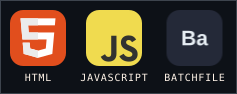

# Ember

A local sales desk for one seller with a lot of items. It tracks what is listed where, who has written in, where each deal stands, and whose move it is. Ember by soybean_alien.

It runs only on this PC (address `127.0.0.1`, port 4319). Nothing is sent anywhere. There is no AI inside it: listings are written in chat with Claude from [PLAYBOOK.md](PLAYBOOK.md) and pasted in.

## Install

Ember needs [Node.js](https://nodejs.org) 22.13 or newer (the current LTS is best) and nothing else. It has no packages to install.

- **Installer:** download `Ember-Setup-<version>.exe` from the [latest release](https://github.com/soybean-alien/ember/releases/latest) and run it. It installs for your Windows user only (no admin rights) and adds **Ember desk** and **Ember wall** to the Start menu. Setup checks for Node.js first and stops if it is missing.
- **From the source:** download or clone this repository and use the two launchers below.

To build the installer yourself, install [Inno Setup 6](https://jrsoftware.org/isinfo.php) and run `ISCC.exe installer\Ember.iss`. The file lands in `installer\Output`.

## Start it

- Double-click **Start Ember.cmd** (or **Ember desk** in the Start menu) for the desk.
- Double-click **Start Ember Wall.cmd** (or **Ember wall**) for the wall. Drag that window to the TV and double-click it for full screen.
- Open the desk and the wall in any order, as often as you like: both use the one Ember that is already running and start it only if it isn't. If another program holds port 4319, the launcher says so.
- To stop it, close the minimized "Ember" window.
- Fill in **Pickup details** (left) once: your payment methods, meet-up spot, and town and postcode or zip.
- Set **Region** (left) once: the country decides the date format and which eBay site the research links open, and the currency is used for new items. Each item keeps its own currency and amounts are never converted.

## The desk

- **Add item** (top right): a name and an asking price make a ticket.
- **Queue** lists every ticket, most urgent first. **Board** shows the same tickets in coloured columns.
- **Your move** (top) lists every follow-up that is due. Click one to open its ticket. **Done** or **Dismiss** clears it, and **Snooze** brings it back later; none of them change the buyer's status. A new move by the buyer makes a new reminder.
- Click a ticket to open it: buyers, postings, listing text with copy buttons, photos and notes.
- There is no Save button. Each box saves when you click or tab out of it, and a "Saved" note appears at the bottom. An open ticket also picks up changes made elsewhere within about ten seconds.
- **+ Someone messaged** adds a buyer in one click. **Accepted** asks for the price you agreed, moves the deal to closing and copies the wrap-up message with that price.
- Each buyer keeps their **offer** and **agreed price** apart from your asking price. **Paid and picked up** asks what they actually paid (the agreed price, unless you correct it) and records the sale at that. **Undo** puts the buyer and the listings back and keeps the offer and agreed price.
- **Pickup day and time** is a real date and time. Once a pickup is confirmed, Ember reminds you before it (one hour by default; change it under **Pickup details**). Rescheduling moves the reminder, and a pickup time that passes with no handover asks you to record it.
- After a sale, Ember can't take your listings down on Facebook or eBay. **Your move** lists each one with its link until you press **I took it down**.
- **Pickup details** (left) hold the payment, meet-up spot and town used in that message.
- **Going rate** (in each ticket): **eBay sold prices** opens eBay's sold listings for the item, used condition. Type the lowest, typical and highest prices you see. Ember suggests an asking price (the typical sold price, less your **Local pickup discount** from the left menu) and shows your asking price as a percentage of typical. After 30 days it asks you to check again. Nothing is fetched automatically.
- **Tutorial** (left) walks one practice sale from start to finish. It points at each control and moves on when you use it. It starts by itself the first time Ember opens with no items, and offers to delete the practice ticket at the end.

## Where a deal can be

| Colour | Stage | What Ember asks of you |
|---|---|---|
| Grey | Draft | Post it |
| Blue | Listed | After 3 quiet days: swap in the second version |
| Orange | They contacted me | Reply and offer two pickup times |
| Yellow | They asked a question | Answer it |
| Red | They counteroffered | Send the calm asking-price reply |
| Violet | They're thinking it over | One check-in after a day |
| Ice blue | They haven't responded | One nudge after a day, then let it go |
| Lime | They accepted | Send the wrap-up message, set a time |
| Teal | Pickup set | Confirm it |
| Green | Sold | Two days later: send the thank-you and feedback message |

The stage is worked out from the buyers and postings on the ticket. Nothing is dragged by hand.

The small dot beside a buyer is the ember. It is bright orange the moment they make a move and fades over two days, so a glance shows which deals are still warm.

## Where the data is

- `data/listings.db` holds everything. `data/photos` holds the photos.
- Ember backs up `data` by itself once a day when it starts (keeping the last ten) and before any upgrade changes the database. **Back up now** (left) makes one at any time. Backups are in `data/backups`.
- To restore one, close Ember, then run `node server.js --restore` in the Ember folder to list them and `node server.js --restore <name>` to put one back. The current data is backed up first, so a restore can be undone.
- To start over, delete the `data` folder.
- The `data` folder is never part of this repository, and uninstalling Ember leaves it in place.

## Files

- `server.js`: the whole server. Node's built-in SQLite, no packages.
- `launch.cmd`: shared by both launchers; reuses a running Ember or starts one.
- `test/`: regression tests with Node's built-in test runner. Run `npm test`.
- `public/index.html`: the desk. `public/wall.html`: the wall. `public/shared.js`: stages, colours and the two canned messages.
- `assets/`: the banner and its mockups.
- `installer/Ember.iss`: the Inno Setup script for the installer.
- `docs/adr/`: architecture decisions. Read them before changing how Ember is built. [ADR-0001](docs/adr/0001-no-runtime-packages.md): no runtime packages without the owner's approval.

## Thanks

- [@Peteskis](https://github.com/Peteskis) reviewed Ember 0.1.0 and found the seven problems fixed in 0.1.1 ([issue #2](https://github.com/soybean-alien/ember/issues/2)).

## License

Ember by soybean_alien. Licensed under the **GPL-3.0** (see [LICENSE](LICENSE)).
